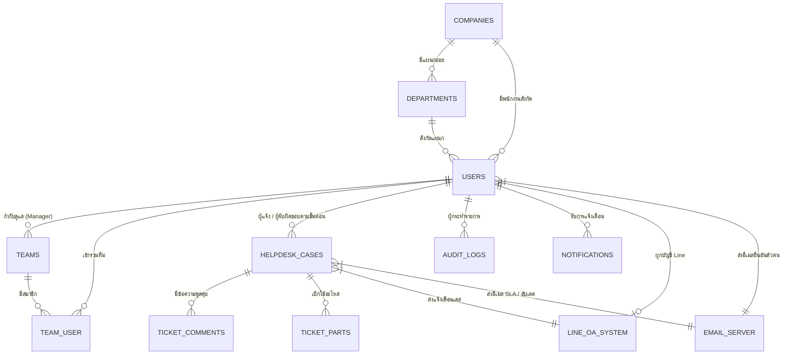
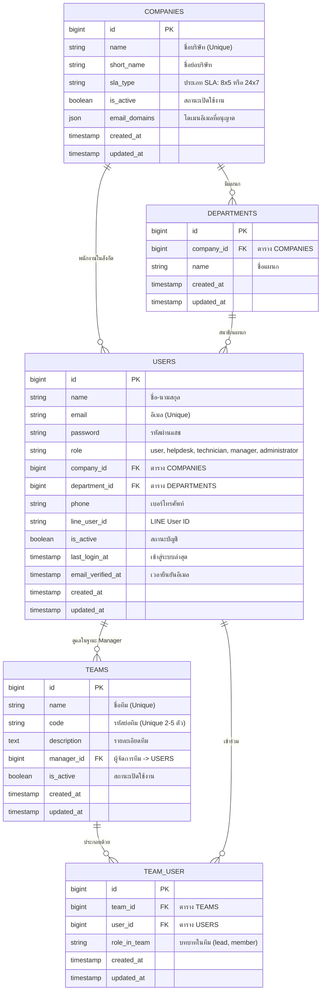
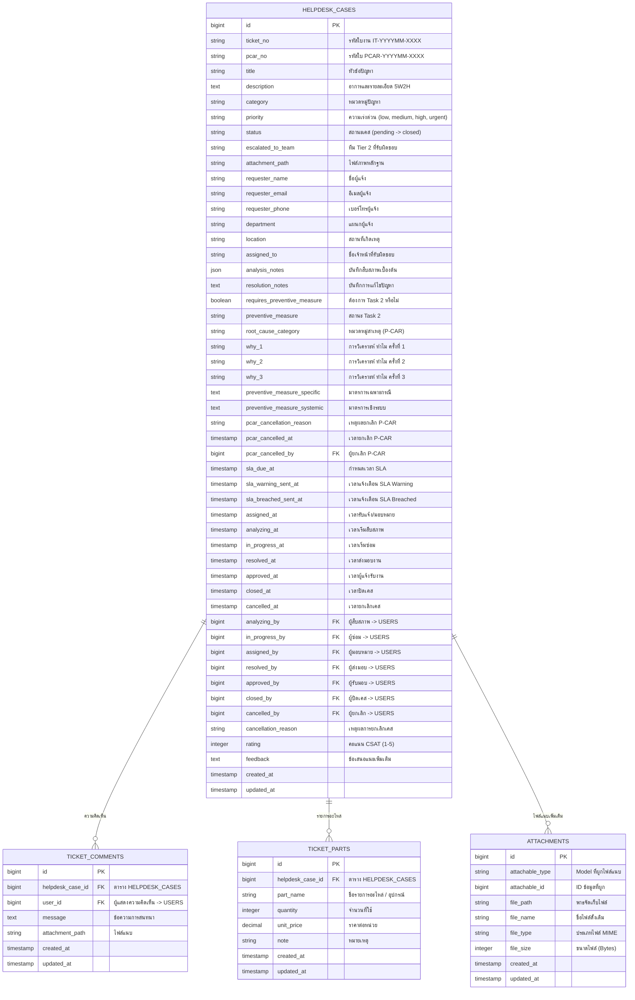
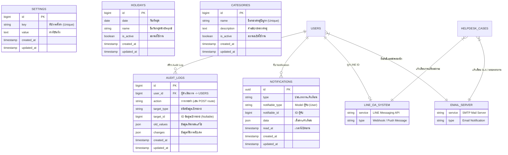

# Entity-Relationship (ER) Diagram

แผนภาพแสดงความสัมพันธ์ของฐานข้อมูลสำหรับระบบ **ITDeskService** โดยรองรับระบบบริการตามมาตรฐาน ITIL 4 ประกอบด้วย Tier 1 (Helpdesk) และ Tier 2 (Hardware, Network, Software) พร้อมการจัดการบริษัทแบบ Dynamic, โครงสร้างทีมงาน, ระบบงานป้องกันปัญหา (P-CAR), การบันทึกประวัติการตรวจสอบ (Audit Logs) และการเชื่อมต่อระบบภายนอก

---

## 1. ภาพรวมสถาปัตยกรรมระดับสูง (High-Level Entity Relationship)

แผนภาพแสดงความสัมพันธ์เชิงแนวคิด (Conceptual Overview) ระหว่างเอนทิตีหลักทั้งหมดในระบบ เพื่อให้เห็น Flow การเชื่อมโยงโดยรวมอย่างชัดเจน

---

## 2. แผนภาพความสัมพันธ์รายโมดูล (Detailed Domain Diagrams)

### 2.1 โมดูลองค์กร ผู้ใช้งาน และทีมงาน (Identity, Organization & Teams)

---

### 2.2 โมดูลระบบใบงานและมาตรการป้องกันปัญหา (Tickets & P-CAR Lifecycle)

---

### 2.3 โมดูลการตั้งค่า บันทึกประวัติ และการเชื่อมต่อภายนอก (Settings, Audit Logs & Integrations)

---

## 3. พจนานุกรมข้อมูลและรายละเอียดสคีมา (Data Dictionary)

### 3.1 ตาราง `COMPANIES` (ข้อมูลบริษัทและข้อตกลง SLA)
ตารางจัดเก็บข้อมูลบริษัทในระบบ รองรับแบบไดนามิก และกำหนดประเภท SLA ประจำบริษัท

| ฟิลด์ (Field) | ชนิดข้อมูล (Data Type) | คีย์ / ค่าว่าง | คำอธิบาย (Description) |
| :--- | :--- | :---: | :--- |
| `id` | `BIGINT UNSIGNED` | **PK** | รหัสประจำตัวบริษัท |
| `name` | `VARCHAR(255)` | **Unique**, Not Null | ชื่อบริษัท |
| `short_name` | `VARCHAR(50)` | Nullable | ชื่อย่อบริษัท สำหรับการแสดงผลแบบกระชับ |
| `sla_type` | `VARCHAR(20)` | Not Null | ประเภท SLA เริ่มต้น: `8x5` (เวลาทำการ) หรือ `24x7` (ตลอดเวลา) |
| `is_active` | `TINYINT(1)` | Not Null, Default `1` | สถานะเปิดใช้งาน (`1` = ปกติ, `0` = ระงับ) |
| `email_domains` | `JSON` | Nullable | โดเมนอีเมลที่อนุญาตให้ผู้ใช้ลงทะเบียนสังกัดบริษัทนี้ |
| `created_at` | `TIMESTAMP` | Nullable | วันเวลาที่สร้างข้อมูล |
| `updated_at` | `TIMESTAMP` | Nullable | วันเวลาที่แก้ไขข้อมูลล่าสุด |

---

### 3.2 ตาราง `DEPARTMENTS` (ข้อมูลแผนก)
ตารางจัดเก็บแผนกย่อยที่สังกัดภายใต้แต่ละบริษัท

| ฟิลด์ (Field) | ชนิดข้อมูล (Data Type) | คีย์ / ค่าว่าง | คำอธิบาย (Description) |
| :--- | :--- | :---: | :--- |
| `id` | `BIGINT UNSIGNED` | **PK** | รหัสประจำตัวแผนก |
| `company_id` | `BIGINT UNSIGNED` | **FK**, Not Null | รหัสบริษัทต้นสังกัด (`COMPANIES.id`) |
| `name` | `VARCHAR(255)` | Not Null | ชื่อแผนก |
| `created_at` | `TIMESTAMP` | Nullable | วันเวลาที่สร้างข้อมูล |
| `updated_at` | `TIMESTAMP` | Nullable | วันเวลาที่แก้ไขข้อมูลล่าสุด |

---

### 3.3 ตาราง `USERS` (ข้อมูลบัญชีผู้ใช้งาน)
ตารางจัดเก็บบัญชีผู้ใช้งานทุกบทบาทตามมาตรฐาน ITIL 4 และเก็บความสัมพันธ์กับบริษัท/แผนก

| ฟิลด์ (Field) | ชนิดข้อมูล (Data Type) | คีย์ / ค่าว่าง | คำอธิบาย (Description) |
| :--- | :--- | :---: | :--- |
| `id` | `BIGINT UNSIGNED` | **PK** | รหัสประจำตัวผู้ใช้งาน |
| `name` | `VARCHAR(255)` | Not Null | ชื่อและนามสกุล (ห้าม Admin แก้ชื่อตนเองผ่านหน้าเว็บ) |
| `email` | `VARCHAR(255)` | **Unique**, Not Null | อีเมลผู้ใช้งาน (ใช้เข้าสู่ระบบ) |
| `password` | `VARCHAR(255)` | Not Null | รหัสผ่านที่เข้ารหัสแฮชด้วย Bcrypt |
| `role` | `VARCHAR(50)` | Not Null | สิทธิ์การใช้งาน: `user`, `helpdesk`, `technician`, `manager`, `administrator` |
| `company_id` | `BIGINT UNSIGNED` | **FK**, Not Null | รหัสบริษัทต้นสังกัด (`COMPANIES.id`) |
| `department_id` | `BIGINT UNSIGNED` | **FK**, Nullable | รหัสแผนกต้นสังกัด (`DEPARTMENTS.id`) |
| `phone` | `VARCHAR(50)` | Nullable | เบอร์โทรศัพท์ติดต่อ (บังคับกรอกตอนเปิดใบงาน) |
| `line_user_id` | `VARCHAR(255)` | Nullable | รหัส LINE User ID สำหรับรับการแจ้งเตือน |
| `is_active` | `TINYINT(1)` | Not Null, Default `1` | สถานะบัญชี (`1` = ปกติ, `0` = ระงับการใช้งาน) |
| `last_login_at` | `TIMESTAMP` | Nullable | เวลาเข้าสู่ระบบล่าสุด (ไม่บันทึกเมื่อ Admin ใช้งานโหมด Impersonation) |
| `email_verified_at` | `TIMESTAMP` | Nullable | เวลายืนยันอีเมล (อัตโนมัติหากสร้างโดย Admin หรือนำเข้าผ่าน CSV) |
| `created_at` | `TIMESTAMP` | Nullable | วันเวลาที่สร้างบัญชี |
| `updated_at` | `TIMESTAMP` | Nullable | วันเวลาที่แก้ไขข้อมูลล่าสุด |

---

### 3.4 ตาราง `TEAMS` และ `TEAM_USER` (ระบบทีมงานแบบไดนามิก)
โครงสร้างทีมช่างเฉพาะทาง (Tier 2 เช่น Hardware, Network, Software) และความสัมพันธ์ของสมาชิก

#### ตาราง `TEAMS`
| ฟิลด์ (Field) | ชนิดข้อมูล (Data Type) | คีย์ / ค่าว่าง | คำอธิบาย (Description) |
| :--- | :--- | :---: | :--- |
| `id` | `BIGINT UNSIGNED` | **PK** | รหัสประจำตัวทีม |
| `name` | `VARCHAR(255)` | **Unique**, Not Null | ชื่อทีมช่างเฉพาะทาง (เมื่อแก้ชื่อ ระบบจะ Cascade อัปเดตในเคสเก่าทั้งหมด) |
| `code` | `VARCHAR(10)` | **Unique**, Not Null | รหัสย่อทีม (2-5 ตัวอักษร เช่น HW, NET, SW) |
| `description` | `TEXT` | Nullable | คำอธิบายหน้าที่ความรับผิดชอบของทีม |
| `manager_id` | `BIGINT UNSIGNED` | **FK**, Nullable | รหัสผู้จัดการ/หัวหน้าทีม (`USERS.id`) |
| `is_active` | `TINYINT(1)` | Not Null, Default `1` | สถานะเปิดใช้งานทีม |
| `created_at` | `TIMESTAMP` | Nullable | วันเวลาที่สร้างทีม |
| `updated_at` | `TIMESTAMP` | Nullable | วันเวลาที่แก้ไขทีมล่าสุด |

#### ตาราง `TEAM_USER`
| ฟิลด์ (Field) | ชนิดข้อมูล (Data Type) | คีย์ / ค่าว่าง | คำอธิบาย (Description) |
| :--- | :--- | :---: | :--- |
| `id` | `BIGINT UNSIGNED` | **PK** | รหัสประจำตัวแถว |
| `team_id` | `BIGINT UNSIGNED` | **FK**, Not Null | รหัสทีม (`TEAMS.id`) |
| `user_id` | `BIGINT UNSIGNED` | **FK**, Not Null | รหัสผู้ใช้งาน (`USERS.id`) |
| `role_in_team` | `VARCHAR(50)` | Not Null, Default `member` | บทบาทในทีม: `lead` (หัวหน้าทีม), `member` (สมาชิกช่าง) |
| `created_at` | `TIMESTAMP` | Nullable | วันเวลาที่เข้าร่วมทีม |
| `updated_at` | `TIMESTAMP` | Nullable | วันเวลาที่แก้ไขข้อมูล |

---

### 3.5 ตาราง `HELPDESK_CASES` (ใบงานแจ้งซ่อมและวงจรชีวิต P-CAR)
ตารางหลักสำหรับจัดเก็บข้อมูลใบงานแจ้งซ่อม วงจรชีวิต SLA ขั้นตอนการแก้ไข และกระบวนการ Task 2

| หมวดหมู่ข้อมูล | ฟิลด์ (Field) | ชนิดข้อมูล | คุณสมบัติ | คำอธิบาย (Description) |
| :--- | :--- | :--- | :---: | :--- |
| **รหัสและข้อมูลปัญหา** | `id` | `BIGINT UNSIGNED` | **PK** | ลำดับไอดีภายในฐานข้อมูล |
| | `ticket_no` | `VARCHAR(50)` | **Unique**, Not Null | รหัสใบงาน Running Number รายเดือน `IT-YYYYMM-XXXX` |
| | `pcar_no` | `VARCHAR(50)` | **Unique**, Nullable | รหัสใบ P-CAR Form `PCAR-YYYYMM-XXXX` (เมื่อเปิด Task 2) |
| | `title` | `VARCHAR(255)` | Not Null | หัวข้อปัญหา |
| | `description` | `LONGTEXT` | Not Null | อาการและรายละเอียดปัญหา (แนะนำตามหลัก 5W2H) |
| | `category` | `VARCHAR(100)` | Not Null | หมวดหมู่ปัญหา (ผู้แจ้งเริ่มเป็น "อื่นๆ" ให้ Tier 1 ประเมิน) |
| | `priority` | `VARCHAR(20)` | Not Null | ความเร่งด่วน: `low`, `medium`, `high`, `urgent` |
| | `status` | `VARCHAR(50)` | Not Null | สถานะ: `pending`, `assigned`, `analyzing`, `in_progress`, `resolved`, `closed`, `cancelled` |
| | `escalated_to_team` | `VARCHAR(255)` | Nullable | ทีมช่างเฉพาะทาง Tier 2 ที่ได้รับมอบหมาย |
| | `attachment_path` | `VARCHAR(255)` | Nullable | พาธไฟล์ภาพหลักฐานเริ่มต้นตอนเปิดเคส |
| **ข้อมูลผู้แจ้ง** | `requester_name` | `VARCHAR(255)` | Not Null | ชื่อผู้แจ้งซ่อม (เฉพาะ Role `user` ที่เปิดได้) |
| | `requester_email` | `VARCHAR(255)` | Not Null | อีเมลติดต่อผู้แจ้ง |
| | `requester_phone` | `VARCHAR(50)` | Not Null | เบอร์โทรศัพท์ติดต่อ (บังคับกรอก) |
| | `department` | `VARCHAR(255)` | Not Null | แผนกของผู้แจ้ง |
| | `location` | `VARCHAR(255)` | Not Null | สถานที่เกิดเหตุ / จุดที่ต้องการให้เข้าซ่อม (บังคับกรอก) |
| **การแก้ไขและ P-CAR** | `assigned_to` | `VARCHAR(255)` | Nullable | ชื่อเจ้าหน้าที่/ช่างที่รับผิดชอบหลัก |
| | `analysis_notes` | `JSON` | Nullable | ข้อมูลการสืบสภาพและสาเหตุปัญหาเบื้องต้น (ก่อนเริ่ม In Progress) |
| | `resolution_notes` | `LONGTEXT` | Nullable | บันทึกการแก้ไขปัญหาเฉพาะหน้า (แก้ได้ตลอดผ่าน Inline Edit) |
| | `requires_preventive_measure` | `TINYINT(1)` | Default `0` | ต้องการมาตรการป้องกันปัญหา Task 2 หรือไม่ (Manager กำหนด) |
| | `preventive_measure` | `VARCHAR(50)` | Nullable | สถานะ Task 2: `assigned`, `in_progress`, `pending_review`, `done`, `cancelled` |
| | `root_cause_category` | `VARCHAR(100)` | Nullable | หมวดหมู่สาเหตุรากเหง้า (เช่น Man, Machine, Method, Material) |
| | `why_1` - `why_3` | `TEXT` | Nullable | บันทึกการวิเคราะห์สาเหตุเชิงลึกตามหลัก 3-Why Analysis |
| | `preventive_measure_specific` | `TEXT` | Nullable | มาตรการป้องกันปัญหาเฉพาะกรณี |
| | `preventive_measure_systemic` | `TEXT` | Nullable | มาตรการป้องกันปัญหาระยะยาวเชิงระบบ |
| | `pcar_cancellation_reason` | `TEXT` | Nullable | เหตุผลในการยกเลิก P-CAR (กรณี Manager เปลี่ยนใจ) |
| | `pcar_cancelled_at` | `TIMESTAMP` | Nullable | วันเวลาที่ยกเลิก P-CAR |
| | `pcar_cancelled_by` | `BIGINT UNSIGNED` | **FK**, Nullable | ผู้กดยกเลิก P-CAR (`USERS.id`) |
| **SLA และเวลาแต่ละช่วง** | `sla_due_at` | `TIMESTAMP` | Nullable | กำหนดเวลาเสร็จสิ้นตามเกณฑ์ SLA ของบริษัท |
| | `sla_warning_sent_at` | `TIMESTAMP` | Nullable | เวลาส่งแจ้งเตือนเตือนใกล้หมด SLA (ป้องกันส่งซ้ำ) |
| | `sla_breached_sent_at` | `TIMESTAMP` | Nullable | เวลาส่งแจ้งเตือนเคสเกินกำหนด SLA (ป้องกันส่งซ้ำ) |
| | `assigned_at` | `TIMESTAMP` | Nullable | วันเวลาที่รับแจ้ง/ส่งต่อมอบหมายงาน (T1) |
| | `analyzing_at` | `TIMESTAMP` | Nullable | วันเวลาที่ช่างเริ่มกดตรวจสอบ/สืบสภาพ (T2) |
| | `in_progress_at` | `TIMESTAMP` | Nullable | วันเวลาที่ช่างเริ่มลงมือปฏิบัติการซ่อม (T3) |
| | `resolved_at` | `TIMESTAMP` | Nullable | วันเวลาที่ส่งมอบงานให้ผู้แจ้ง (T5) -> **หยุดนับเวลา SLA ทันที** |
| | `approved_at` | `TIMESTAMP` | Nullable | วันเวลาที่ผู้แจ้งกดยืนยันรับผลงาน (Accept Resolution) |
| | `closed_at` | `TIMESTAMP` | Nullable | วันเวลาที่ปิดใบงานอย่างสมบูรณ์ |
| | `cancelled_at` | `TIMESTAMP` | Nullable | วันเวลาที่ยกเลิกใบงาน |
| **ผู้กระทำในแต่ละขั้นตอน** | `assigned_by` | `BIGINT UNSIGNED` | **FK**, Nullable | เจ้าหน้าที่ Tier 1 ผู้มอบหมายงาน (`USERS.id`) |
| | `analyzing_by` | `BIGINT UNSIGNED` | **FK**, Nullable | ช่างผู้เข้าตรวจสอบสืบสภาพ (`USERS.id`) |
| | `in_progress_by` | `BIGINT UNSIGNED` | **FK**, Nullable | ช่างผู้ลงมือแก้ไข (`USERS.id`) |
| | `resolved_by` | `BIGINT UNSIGNED` | **FK**, Nullable | เจ้าหน้าที่ผู้กดส่งมอบงาน (`USERS.id`) |
| | `approved_by` | `BIGINT UNSIGNED` | **FK**, Nullable | ผู้แจ้งที่กดยืนยันรับงาน (`USERS.id`) |
| | `closed_by` | `BIGINT UNSIGNED` | **FK**, Nullable | ผู้ปิดใบงาน (`USERS.id`) |
| | `cancelled_by` | `BIGINT UNSIGNED` | **FK**, Nullable | ผู้กดยกเลิกใบงาน (`USERS.id`) |
| | `cancellation_reason` | `TEXT` | Nullable | เหตุผลที่ยกเลิกเคส (บังคับระบุ) |
| **ความพึงพอใจ (CSAT)** | `rating` | `TINYINT` | Nullable | คะแนนความพึงพอใจ 1-5 ดาว (บังคับตอบตอนกดยืนยันรับงาน) |
| | `feedback` | `TEXT` | Nullable | ข้อเสนอแนะเพิ่มเติมจากผู้แจ้ง |
| **ระบบ** | `created_at` | `TIMESTAMP` | Nullable | วันเวลาที่เปิดใบงาน |
| | `updated_at` | `TIMESTAMP` | Nullable | วันเวลาที่แก้ไขข้อมูลล่าสุด |

---

### 3.6 ตาราง `TICKET_COMMENTS` (การสื่อสารโต้ตอบในใบงาน)
บันทึกข้อความสนทนาระหว่างผู้แจ้งและทีมงานไอที รวมถึงบันทึก Audit Trail อัตโนมัติจากระบบ

| ฟิลด์ (Field) | ชนิดข้อมูล (Data Type) | คีย์ / ค่าว่าง | คำอธิบาย (Description) |
| :--- | :--- | :---: | :--- |
| `id` | `BIGINT UNSIGNED` | **PK** | รหัสประจำตัวข้อความ |
| `helpdesk_case_id` | `BIGINT UNSIGNED` | **FK**, Not Null | รหัสใบงาน (`HELPDESK_CASES.id`) |
| `user_id` | `BIGINT UNSIGNED` | **FK**, Not Null | ผู้ส่งข้อความ (`USERS.id`) |
| `message` | `LONGTEXT` | Not Null | เนื้อหาข้อความพูดคุย หรือข้อความแจ้งเตือนจากระบบ |
| `attachment_path` | `VARCHAR(255)` | Nullable | ไฟล์ภาพหรือเอกสารแนบในข้อความ |
| `created_at` | `TIMESTAMP` | Nullable | วันเวลาที่ส่งข้อความ (รองรับ Auto-refresh บนหน้าจอ) |
| `updated_at` | `TIMESTAMP` | Nullable | วันเวลาที่แก้ไขข้อความ |

---

### 3.7 ตาราง `TICKET_PARTS` (รายการอะไหล่และอุปกรณ์ที่ใช้)
บันทึกรายการอะไหล่ที่ช่างเบิกใช้ในการซ่อมแซมใบงาน

| ฟิลด์ (Field) | ชนิดข้อมูล (Data Type) | คีย์ / ค่าว่าง | คำอธิบาย (Description) |
| :--- | :--- | :---: | :--- |
| `id` | `BIGINT UNSIGNED` | **PK** | รหัสประจำตัวรายการอะไหล่ |
| `helpdesk_case_id` | `BIGINT UNSIGNED` | **FK**, Not Null | รหัสใบงาน (`HELPDESK_CASES.id`) |
| `part_name` | `VARCHAR(255)` | Not Null | ชื่อรายการอะไหล่ หรืออุปกรณ์ที่เปลี่ยน |
| `quantity` | `INT` | Not Null, Default `1` | จำนวนที่ใช้งาน |
| `unit_price` | `DECIMAL(10,2)` | Nullable | ราคาต่อหน่วย (สำหรับรายงานต้นทุน) |
| `note` | `VARCHAR(255)` | Nullable | หมายเหตุเพิ่มเติม |
| `created_at` | `TIMESTAMP` | Nullable | วันเวลาที่บันทึก |
| `updated_at` | `TIMESTAMP` | Nullable | วันเวลาที่อัปเดต |

---

### 3.8 ตาราง `ATTACHMENTS` (ไฟล์แนบระบบแบบ Polymorphic)
จัดเก็บข้อมูลไฟล์แนบที่ผูกกับข้อมูลส่วนต่างๆ ในระบบ

| ฟิลด์ (Field) | ชนิดข้อมูล (Data Type) | คีย์ / ค่าว่าง | คำอธิบาย (Description) |
| :--- | :--- | :---: | :--- |
| `id` | `BIGINT UNSIGNED` | **PK** | รหัสประจำตัวไฟล์แนบ |
| `attachable_type` | `VARCHAR(255)` | Not Null | ชื่อ Model ที่ผูกไฟล์ (เช่น `App\Models\HelpdeskCase`) |
| `attachable_id` | `BIGINT UNSIGNED` | Not Null | รหัสไอดีของ Model ที่ผูก |
| `file_path` | `VARCHAR(255)` | Not Null | พาธไฟล์ใน Storage |
| `file_name` | `VARCHAR(255)` | Not Null | ชื่อไฟล์ต้นฉบับ |
| `file_type` | `VARCHAR(100)` | Not Null | MIME Type ของไฟล์ (เช่น `image/png`, `image/jpeg`) |
| `file_size` | `INT` | Not Null | ขนาดของไฟล์ในหน่วย Bytes (จำกัดไม่เกิน 5MB) |
| `created_at` | `TIMESTAMP` | Nullable | วันเวลาที่อัปโหลด |
| `updated_at` | `TIMESTAMP` | Nullable | วันเวลาที่แก้ไข |

---

### 3.9 ตาราง `SETTINGS` (การตั้งค่าระบบ)
ตารางบันทึกค่าคอนฟิกูเรชันของระบบแบบ Key-Value คู่ขนาน

| ฟิลด์ (Field) | ชนิดข้อมูล (Data Type) | คีย์ / ค่าว่าง | คำอธิบาย (Description) |
| :--- | :--- | :---: | :--- |
| `id` | `BIGINT UNSIGNED` | **PK** | รหัสประจำตัวการตั้งค่า |
| `key` | `VARCHAR(100)` | **Unique**, Not Null | คีย์การตั้งค่า (เช่น `app_name`, `support_contact`, `app_logo`, `app_logo_login`, `app_favicon`, `smtp_host`, `smtp_port`, `smtp_username`, `smtp_password`, `smtp_encryption`, `sla_alert_enabled`, `sla_warning_threshold_minutes`, `audit_log_retention_years`) |
| `value` | `LONGTEXT` | Nullable | ค่าคอนฟิกูเรชัน |
| `created_at` | `TIMESTAMP` | Nullable | วันเวลาที่สร้าง |
| `updated_at` | `TIMESTAMP` | Nullable | วันเวลาที่อัปเดตล่าสุด |

---

### 3.10 ตาราง `HOLIDAYS` (วันหยุดนักขัตฤกษ์สำหรับคำนวณ SLA)
ตารางจัดเก็บวันหยุดประจำปีสำหรับนำไปหักลบเวลาคำนวณ SLA 8x5

| ฟิลด์ (Field) | ชนิดข้อมูล (Data Type) | คีย์ / ค่าว่าง | คำอธิบาย (Description) |
| :--- | :--- | :---: | :--- |
| `id` | `BIGINT UNSIGNED` | **PK** | รหัสประจำตัววันหยุด |
| `date` | `DATE` | **Unique**, Not Null | วันที่หยุด (ไม่อนุญาตให้เพิ่ม/ลบวันหยุดย้อนหลัง เพื่อรักษาความเที่ยงตรงของ SLA) |
| `name` | `VARCHAR(255)` | Not Null | ชื่อวันหยุดนักขัตฤกษ์ |
| `is_active` | `TINYINT(1)` | Not Null, Default `1` | สถานะเปิดใช้งาน |
| `created_at` | `TIMESTAMP` | Nullable | วันเวลาที่สร้าง |
| `updated_at` | `TIMESTAMP` | Nullable | วันเวลาที่แก้ไข |

---

### 3.11 ตาราง `CATEGORIES` (หมวดหมู่ปัญหา)
ตารางจัดเก็บประเภทอุปกรณ์หรือหมวดหมู่งานซ่อมบำรุง

| ฟิลด์ (Field) | ชนิดข้อมูล (Data Type) | คีย์ / ค่าว่าง | คำอธิบาย (Description) |
| :--- | :--- | :---: | :--- |
| `id` | `BIGINT UNSIGNED` | **PK** | รหัสหมวดหมู่ |
| `name` | `VARCHAR(255)` | **Unique**, Not Null | ชื่อหมวดหมู่ปัญหา |
| `description` | `TEXT` | Nullable | คำอธิบายรายละเอียดของหมวดหมู่ |
| `is_active` | `TINYINT(1)` | Not Null, Default `1` | สถานะเปิดใช้งาน |
| `created_at` | `TIMESTAMP` | Nullable | วันเวลาที่สร้าง |
| `updated_at` | `TIMESTAMP` | Nullable | วันเวลาที่แก้ไข |

---

### 3.12 ตาราง `AUDIT_LOGS` (บันทึกประวัติการตรวจสอบย้อนหลัง)
ตารางบันทึกการกระทำสำคัญของผู้ดูแลระบบ (Administrator) เพื่อความโปร่งใสและตรวจสอบได้

| ฟิลด์ (Field) | ชนิดข้อมูล (Data Type) | คีย์ / ค่าว่าง | คำอธิบาย (Description) |
| :--- | :--- | :---: | :--- |
| `id` | `BIGINT UNSIGNED` | **PK** | รหัสประจำตัวล็อก |
| `user_id` | `BIGINT UNSIGNED` | **FK**, Not Null | ผู้กระทำรายการ (`USERS.id`) |
| `action` | `VARCHAR(255)` | Not Null | กิจกรรมที่กระทำ (เช่น การเรียก Route, สร้าง, แก้ไข, ลบ) |
| `target_type` | `VARCHAR(255)` | Not Null | ข้อมูลหรือโมดูลเป้าหมาย |
| `target_id` | `BIGINT UNSIGNED` | Nullable | ID ข้อมูลเป้าหมาย (กรณีตั้งค่าระบบจะเป็น `null` เพื่อป้องกัน MySQL 1366 Error) |
| `old_values` | `JSON` | Nullable | ข้อมูลเดิมก่อนการเปลี่ยนแปลง |
| `changes` | `JSON` | Nullable | ข้อมูลใหม่ที่มีการเปลี่ยนแปลง |
| `created_at` | `TIMESTAMP` | Nullable | วันเวลาที่เกิดกิจกรรม |
| `updated_at` | `TIMESTAMP` | Nullable | วันเวลาที่อัปเดต |

---

### 3.13 ตาราง `NOTIFICATIONS` (การแจ้งเตือนภายในระบบ)
ตารางจัดเก็บ Notification ของ Laravel รองรับการแจ้งเตือนแบบ In-app Alert

| ฟิลด์ (Field) | ชนิดข้อมูล (Data Type) | คีย์ / ค่าว่าง | คำอธิบาย (Description) |
| :--- | :--- | :---: | :--- |
| `id` | `CHAR(36)` | **PK** (UUID) | รหัส UUID ประจำการแจ้งเตือน |
| `type` | `VARCHAR(255)` | Not Null | คลาสการแจ้งเตือน (Notification Class) |
| `notifiable_type` | `VARCHAR(255)` | Not Null | ชนิดของโมเดลผู้รับ (เช่น `App\Models\User`) |
| `notifiable_id` | `BIGINT UNSIGNED` | Not Null | ไอดีของผู้รับ (`USERS.id`) |
| `data` | `TEXT / JSON` | Not Null | ข้อมูลเพย์โหลดการแจ้งเตือน |
| `read_at` | `TIMESTAMP` | Nullable | วันเวลาที่ผู้ใช้งานเปิดอ่าน |
| `created_at` | `TIMESTAMP` | Nullable | วันเวลาที่ส่งการแจ้งเตือน |
| `updated_at` | `TIMESTAMP` | Nullable | วันเวลาที่แก้ไข |

---

## 4. หมายเหตุและกฎทางธุรกิจ (Business Rules & Guidelines)

> [!NOTE]
> **การแสดงตัวอย่าง ER Diagram (ER Diagram Preview):**
> สำหรับการเปิดดูแผนภาพ Mermaid ER Diagram ใน Visual Studio Code สามารถทำได้โดยคลิกขวาที่ไฟล์นี้แล้วเลือก **"Markdown: Open Preview"** (หรือกดคีย์ลัด `Ctrl + Shift + V` / `Ctrl + K V`) โดยการแยกเป็นโมดูลย่อยจะช่วยให้เรนเดอร์ได้คมชัด อ่านง่าย ไม่ถูกย่อส่วนบีบอัดจนเสียรูป

1. **การติดตามผู้ปฏิบัติงาน:** ทุกขั้นตอนการเปลี่ยนสถานะ ระบบจะบันทึก ID ของผู้ใช้งานที่กดทำรายการไว้ (`assigned_by`, `analyzing_by`, `in_progress_by`, `resolved_by`, `approved_by`, `closed_by`, `cancelled_by`)
2. **การคำนวณ SLA และตารางวันหยุด (SLA 8x5 & Holidays Relation):** ฟิลด์ `COMPANIES.sla_type` สัมพันธ์กับตาราง `HOLIDAYS` โดยหากเป็นรูปแบบ 8x5 ระบบจะคำนวณเฉพาะช่วงเวลาทำการ (08:00-12:00, 13:00-17:00 จันทร์-ศุกร์) และเว้นวันหยุดนักขัตฤกษ์ที่มีสถานะ Active
3. **การส่งมอบงานและการหยุดนับเวลา SLA (Handover & SLA Pausing):** ช่างสามารถบันทึกข้อความการแก้ไขเฉพาะหน้า (`resolution_notes`) ได้ตลอดเวลาในระหว่างซ่อม (`in_progress`) และเมื่อส่งงานให้ผู้แจ้งแล้วจริง ๆ จึงกด Action "ส่งมอบงานให้ผู้แจ้ง" เพื่อเปลี่ยนสถานะเป็น `resolved` ("รอผู้แจ้งกดรับงาน") พร้อม**หยุดการนับเวลา SLA ทันที**
4. **การรับทราบผลงาน (Acceptance & CSAT):** ผู้แจ้งเป็นผู้กดรับงานและให้คะแนนความพึงพอใจ CSAT เพื่อเปลี่ยนสถานะเป็นปิดใบงาน (`closed`) ทันที (Helpdesk กดแทนได้เมื่อเวลาผ่านไปครบ 5 นาที)
5. **การตรวจสอบย้อนหลัง (Manager Review) และสิทธิ์การเริ่ม Task 2:** หลังจากใบงานปิดแล้ว Manager (Tier 3) เข้ามาตรวจสอบเพื่อระบุว่าต้องการมาตรการป้องกันปัญหา (Preventive Measure - Task 2) หรือไม่ โดยสิทธิ์การกดเริ่มดำเนินการป้องกัน (`start_preventive_measure`) ถูกจำกัดให้เฉพาะช่างเฉพาะทาง (Tier 2 Technical Specialist) ของทีมที่ได้รับมอบหมายเท่านั้น
6. **การแยกบริบทข้อมูลสำหรับผู้ใช้งานทั่วไป (User Dashboard PCAR Isolation):** ในหน้า Dashboard ของ Role `user` (ทั้งตารางในโหมดเดสก์ท็อปและการ์ดในโหมดมือถือ) รวมถึงส่วนหัวของหน้ารายละเอียดใบงาน จะไม่แสดงสถานะ PCAR หรือเลขที่ PCAR เพื่อแยกกระบวนการภายในของฝ่าย IT ออกจากมุมมองของผู้ใช้งาน
7. **ระบบแจ้งเตือน SLA Overdue Warning Alert:** ตาราง `HELPDESK_CASES` มีฟิลด์ `sla_warning_sent_at` และ `sla_breached_sent_at` สำหรับบันทึกเวลาที่ส่งการแจ้งเตือนเคสใกล้หมดเวลา SLA และเคสเกินเวลา SLA ป้องกันการส่งซ้ำ
8. **ระบบเสียงแจ้งเตือนสังเคราะห์และตัวเลือกโทนเสียง (Audio Notifications & Tone Selector):** ระบบเสียงแจ้งเตือนสังเคราะห์ผ่าน Web Audio API และบันทึกการตั้งค่าเปิด/ปิด (`itdesk_sound_enabled`) รวมถึงรูปแบบโทนเสียง (`itdesk_sound_tone`) ลงใน `localStorage` ของเบราว์เซอร์ผู้ใช้โดยตรง จึงไม่สร้าง Overhead หรือฟิลด์เพิ่มเติมในฐานข้อมูล
9. **สถาปัตยกรรม 5 บทบาทสากล (ITIL 4 Standard Core Roles) และระบบทีมงานแบบไดนามิก (Dynamic Teams):** ระบบยึดโครงสร้างระดับสิทธิ์ 5 บทบาทหลัก (`administrator`, `manager`, `technician`, `helpdesk`, `user`) โดยแยกสายงานความเชี่ยวชาญ (Hardware, Network, Software หรือทีมอื่นๆ ในอนาคต) ออกจาก Role และบริหารจัดการผ่านตาราง `TEAMS` และ `TEAM_USER` แทน โดยหัวหน้างาน (`manager`) จะติดตามภาระงาน (Technician Workload) ของช่างในทีมตนเองตามความสัมพันธ์ `managedTeams()` แบบไดนามิก 100% ขณะที่ `administrator` และ General Manager สามารถติดตามภาพรวมของทุกทีมได้
10. **การจัดการบัญชีผู้ใช้งาน, การเลื่อนขั้น (Promote) และลดบทบาท (Demote):** ผู้ใช้ทั่วไปสร้างบัญชีตนเองผ่านระบบลงทะเบียน (`/register`) โดยสงวนสิทธิ์การสร้าง/แก้ไข/ลบ/นำเข้าบัญชีให้เฉพาะ Administrator เท่านั้น ขณะที่ Helpdesk (Tier 1) และ Tier 3 Manager มีสิทธิ์ส่งลิงก์รีเซ็ตรหัสผ่าน โดย Tier 3 Manager สามารถเลื่อนขั้นผู้ใช้ทั่วไป (`role = 'user'`) เป็นทีมไอที (`helpdesk` หรือ `technician` ในทีมที่ตนดูแล) ผ่านกระบวนการ Promote (ตรวจสอบ Separation of Duties ห้ามเลื่อนขั้นหากมีเคสค้าง) และสามารถลดบทบาท (Demote) ทีมงานในสังกัดกลับเป็นผู้ใช้ทั่วไปได้
11. **การจำกัดสิทธิ์ผู้เปิดเคส (Separation of Duties):** สงวนสิทธิ์การเปิดเคสแจ้งซ่อม (`HELPDESK_CASES`) ให้เฉพาะผู้ใช้งานทั่วไป (`role = 'user'`) เท่านั้น เพื่อป้องกันผลประโยชน์ทับซ้อน (Conflict of Interest) โดยทีมงานไอทีและผู้ดูแลระบบทุกบทบาทจะไม่มีสิทธิ์เปิดเคสแจ้งซ่อม (จะถูก Redirect กลับไปหน้า Dashboard หรือปฏิเสธด้วย 403 Forbidden)
12. **External Systems (LINE OA & Email Server):** เป็นระบบภายนอกที่ไม่ได้เก็บข้อมูลเป็นตารางหลักในฐานข้อมูล แต่ระบบ ITDeskService จะเชื่อมต่อผ่าน API และ SMTP เพื่อใช้ในการแจ้งเตือน (Notifications) และยืนยันตัวตน (Email Verification)
13. **การตั้งค่าอัตลักษณ์องค์กรและการจัดหมวดหมู่การตั้งค่าระบบ (Corporate Branding & System Settings):** ตาราง `SETTINGS` บันทึกค่าอัตลักษณ์องค์กร ได้แก่ `app_name`, `support_contact`, และไฟล์ภาพโลโก้/ไอคอน (`app_logo`, `app_logo_login`, `app_favicon`) โดยระบบได้นำฟีเจอร์สีธีมหลัก (`brand_primary_color`) และชื่อบริษัทระดับแบรนด์ (`company_name`) ออก เพื่อรักษาเสถียรภาพของธีมหลัก Indigo/Slate และคงความถูกต้องของโครงสร้างตาราง `COMPANIES` เดิม พร้อมจัดระเบียบหน้าการตั้งค่าระบบเป็น 3 ส่วนหลัก (Corporate Branding, External Integrations, System Policies)
14. **การอนุญาต Inline Edit ในระหว่างดำเนินการ Task 2 (Preventive Measure):** อนุญาตให้ Helpdesk, ช่างเฉพาะทาง (Technician), ผู้จัดการ (Manager) และผู้ดูแลระบบ (Administrator) สามารถแก้ไขข้อมูลการวิเคราะห์สาเหตุ (Why-Why Analysis & Root Cause Detail) และบันทึกการแก้ไขปัญหา (Resolution Notes) ได้ตลอดเวลาในระหว่างการดำเนินงาน Task 2 แม้สถานะหลักของเคสจะถูกปิดไปแล้ว (`closed`) จนกว่า Task 2 จะปิดงาน (`done`) เพื่อให้ข้อมูลในรายงาน P-CAR Form 4 มีความครบถ้วนสมบูรณ์ที่สุด
15. **การบันทึกประวัติการตั้งค่าระบบ (Settings Audit Log Target ID):** สำหรับการบันทึกประวัติการตั้งค่าระบบ (`settings.update`) ตาราง `AUDIT_LOGS` จะกำหนดค่า `target_id = null` เนื่องจากเป็นการปรับแต่งค่าระดับระบบแบบ Key-Value คู่ขนานที่ไม่มี Entity ID ประจำตารางเดี่ยว เพื่อป้องกันข้อผิดพลาด MySQL 1366 Data Truncation Error
16. **การตรวจสอบเวอร์ชันและสถานะของฐานข้อมูล (Database Engine Diagnostics):** ระบบดึงข้อมูลเวอร์ชันของ MySQL/MariaDB จากการเชื่อมต่อฐานข้อมูลโดยตรงผ่าน `PDO::ATTR_SERVER_VERSION` เพื่อนำไปแสดงผลบน Dashboard/Settings โดยไม่มีการเปลี่ยนแปลง Schema หรือโครงสร้างตารางเพิ่มเติม
17. **การจัดการข้อมูลส่วนตัวและความปลอดภัยของบัญชี (Profile Management & Security Architecture):** ฟิลด์ข้อมูลในตาราง `USERS` (ชื่อ, อีเมล, เบอร์โทรศัพท์, สังกัดบริษัท, แผนก, รหัสผ่าน) ได้รับการบริหารจัดการผ่านหน้าจอ `Profile/Edit.jsx` โดยมีระบบป้องกันการแก้ไขชื่อของ Role `administrator` เพื่อรักษาความถูกต้องของ Audit Log, การตรวจสอบและส่งลิงก์ยืนยันอีเมลซ้ำ (`email_verified_at`), และระบบเปลี่ยนรหัสผ่านพร้อมเกณฑ์ความปลอดภัยมาตรฐานสากล
18. **การยกเลิก, Re-activate เลขเดิม และลายน้ำรายงาน P-CAR (PCAR Cancellation, Re-activation & Watermark):** หัวหน้า (Manager - Tier 3) สามารถสลับการตัดสินใจ Task 2 ไปมาได้ตราบใดที่ยังไม่ปิดงาน (`preventive_measure !== 'done'`) โดยหากสลับเป็น "ไม่ต้องการ" ในเคสที่มีเลข PCAR แล้ว ระบบจะบังคับใส่เหตุผล บันทึก `pcar_cancellation_reason`, `pcar_cancelled_at`, `pcar_cancelled_by` ปรับสถานะเป็น `cancelled` และแสดงลายน้ำตรายางยกเลิกสีแดงกลางรายงานพิมพ์ P-CAR Form 4 แต่หากเปลี่ยนใจกลับมาเลือก "ต้องการ" อีกครั้ง ระบบจะ Re-activate นำเลข `pcar_no` เดิมกลับมาใช้ต่อ ปรับสถานะเป็น `in_progress` ปลดลายน้ำออก และบันทึก Audit Comment ทั้งนี้เมื่อปิด Task 2 (`done`) แล้วจะล็อกการแก้ไขถาวร
19. **การอัปเดตชื่อทีมแบบ Cascade (Cascade Team Rename):** เมื่อ Administrator มีการแก้ไขชื่อทีมในตาราง `TEAMS` (`name`) ระบบจะค้นหาและอัปเดตฟิลด์ `escalated_to_team` ในตาราง `HELPDESK_CASES` ทั้งหมดที่ผูกกับชื่อเดิมให้เป็นชื่อใหม่โดยอัตโนมัติทันที เพื่อป้องกันปัญหาข้อมูลชื่อทีมไม่ตรงกันและการสูญหายของความสัมพันธ์เคส
20. **การบันทึกประวัติการยกเลิกเคสลงใน Ticket Comments (Cancellation Audit Trail):** ทุกครั้งที่มีการยกเลิกใบงาน (`cancelled_at`, `cancelled_by`, `cancellation_reason`) หรือการยกเลิก P-CAR ระบบจะสร้างข้อความระบบอัตโนมัติ (System Comment) บันทึกลงในตาราง `TICKET_COMMENTS` โดยระบุชื่อผู้ยกเลิกและเหตุผล เพื่อให้ผู้ใช้งานทุกฝ่ายสามารถตรวจสอบประวัติย้อนหลังผ่านหน้าแสดงรายละเอียดเคสได้อย่างโปร่งใส
21. **การกรองข้อมูลแบบ Zero Dead-ends และประสิทธิภาพคิวรี (Dynamic Filter Options):** ตัวเลือกใน Dropdown ตัวกรองข้อมูลทั้งหมดของระบบ (สถานะ, ความเร่งด่วน, ทีม, ช่าง, บริษัท, แผนก) จะถูกดึงผ่าน Aggregate Query ที่กรองเฉพาะค่าที่มีอยู่จริงในฐานข้อมูลตามบริบทของสิทธิ์ผู้ใช้งาน เพื่อป้องกันไม่ให้ผู้ใช้เลือกตัวกรองแล้วไม่พบข้อมูล
22. **การจัดวางข้อมูลตามบริบท (Context-based Ticket Layout):** จัดกลุ่มข้อมูลผู้แจ้งและผู้แจ้งแทน (`👤 [ผู้แจ้ง] ([แผนก]) ↳ แจ้งแทน [ผู้ใช้จริง]`) แยกบรรทัดกับสถานที่ (`📍 [สถานที่]`) พร้อมตัดความยาว (Truncate) และใส่ Tooltip ช่วยรักษาความสูงของแถวตารางใน Dashboard ให้เป็นระเบียบและสม่ำเสมอสอดคล้องกันทุกอุปกรณ์
23. **การปรับปรุงการแสดงผลคอลัมน์สถานะและ SLA (Status & SLA Presentation Refinement - Issue #4):** แผนการปรับปรุงโครงสร้างการแสดงผล Badges ภายในคอลัมน์สถานะบน Dashboard เพื่อลดการซ้อนทับกันหลายชั้นในแนวตั้ง (Vertical Stacking) และจัดระเบียบสถานะ Task 2 (PCAR) ให้สอดคล้องกับบริบทของเคส
24. **การควบคุมสิทธิ์การลบบัญชีผู้ใช้ (Smart Delete):** หากผู้ใช้ยังไม่มีประวัติผูกกับใบงาน ระบบจะทำการลบถาวร (Hard Delete) เพื่อลดขยะในระบบ แต่หากมีประวัติเคสหรือล็อกผูกอยู่แล้ว ระบบจะระงับการใช้งาน (`is_active = 0`) แทน เพื่อรักษาความสมบูรณ์ของความสัมพันธ์ในฐานข้อมูล (Data Integrity)
