# Entity-Relationship (ER) Diagram

แผนภาพแสดงความสัมพันธ์ของฐานข้อมูลสำหรับระบบ ITDeskService โดยรองรับระบบ Tier 1 (Helpdesk) และ Tier 2 (Hardware, Network, Software) พร้อมรองรับการจัดการข้อมูลบริษัท (Companies) แบบ Dynamic และการแนบไฟล์หลักฐาน

```mermaid
erDiagram
    COMPANIES {
        bigint id PK
        string name "ชื่อบริษัท (Unique)"
        string short_name "ชื่อย่อบริษัท (Nullable)"
        string sla_type "ประเภท SLA: 8x5 หรือ 24x7"
        boolean is_active "สถานะเปิดใช้งาน (True = ใช้งานได้, False = ระงับ)"
        json email_domains "โดเมนอีเมลที่อนุญาต (Nullable)"
        timestamp created_at
        timestamp updated_at
    }

    DEPARTMENTS {
        bigint id PK
        bigint company_id FK
        string name "ชื่อแผนก"
        timestamp created_at
        timestamp updated_at
    }

    USERS {
        bigint id PK
        string name
        string email
        string password
        string role "สิทธิ์หลัก 5 ระดับ (ITIL 4 Standard): user, helpdesk, technician, manager, administrator (พร้อมรองรับ legacy roles เดิม)"
        bigint company_id FK
        bigint department_id FK "เปลี่ยนจาก string เป็น FK"
        string phone
        string line_user_id
        boolean is_active "สถานะบัญชี (True = ใช้งานได้, False = ระงับ)"
        timestamp last_login_at "เวลาเข้าสู่ระบบล่าสุด (Nullable)"
        timestamp email_verified_at "เวลายืนยันอีเมล (Nullable สำหรับผู้สมัครใหม่, บันทึกอัตโนมัติหาก Admin สร้าง/Import)"
        timestamp created_at
        timestamp updated_at
    }

    TEAMS {
        bigint id PK
        string name "ชื่อทีม (Unique)"
        string code "รหัสย่อทีม (Unique 2-5 ตัวอักษร)"
        text description "รายละเอียดทีม (Nullable)"
        bigint manager_id FK "หัวหน้าทีม (Nullable -> USERS)"
        boolean is_active "สถานะเปิดใช้งาน (True = ใช้งานได้, False = ระงับ)"
        timestamp created_at
        timestamp updated_at
    }

    TEAM_USER {
        bigint id PK
        bigint team_id FK "ตาราง TEAMS"
        bigint user_id FK "ตาราง USERS"
        string role_in_team "บทบาทในทีม (lead, member)"
        timestamp created_at
        timestamp updated_at
    }

    HELPDESK_CASES {
        bigint id PK
        string ticket_no "รหัสใบงาน (Unique) รูปแบบ IT-YYYYMM-XXXX (Running Number รายเดือน)"
        string pcar_no "รหัสใบ PCAR (Nullable, Unique) รูปแบบ PCAR-YYYYMM-XXXX"
        string title "หัวข้อปัญหา"
        text description "รายละเอียด"
        string category "ประเภทอุปกรณ์ / หมวดหมู่"
        string priority "ความเร่งด่วน"
        string status "สถานะ (pending, assigned, analyzing, in_progress, resolved, approved, closed, cancelled)"
        string escalated_to_team "ทีม Tier 2 ที่รับผิดชอบ"
        string attachment_path "ภาพหลักฐาน (Nullable)"
        string requester_name "ชื่อผู้แจ้ง"
        string requester_email "อีเมลผู้แจ้ง"
        string requester_phone "เบอร์โทรผู้แจ้ง"
        string department "แผนกของผู้แจ้ง"
        string location "สถานที่เกิดเหตุ"
        string assigned_to "ชื่อเจ้าหน้าที่รับผิดชอบเบื้องต้น"
        json analysis_notes "ข้อมูลสาเหตุของปัญหาเบื้องต้น"
        text resolution_notes "บันทึกการแก้ไขปัญหาเฉพาะหน้า"
        boolean requires_preventive_measure "ต้องการมาตรการป้องกัน (Manager อนุมัติ)"
        string preventive_measure "สถานะ Task 2 (assigned, in_progress, pending_review, done)"
        string root_cause_category "หมวดหมู่สาเหตุ (P-CAR)"
        string why_1 "การวิเคราะห์ ทำไม ครั้งที่ 1"
        string why_2 "การวิเคราะห์ ทำไม ครั้งที่ 2"
        string why_3 "การวิเคราะห์ ทำไม ครั้งที่ 3"
        text preventive_measure_specific "มาตรการป้องกันเฉพาะกรณี"
        text preventive_measure_systemic "มาตรการป้องกันทั้งระบบ"
        timestamp sla_due_at "กำหนดเสร็จ SLA"
        timestamp sla_warning_sent_at "เวลาที่ส่งแจ้งเตือน SLA Warning (Nullable)"
        timestamp sla_breached_sent_at "เวลาที่ส่งแจ้งเตือน SLA Breached (Nullable)"
        timestamp assigned_at "เวลารับแจ้ง/มอบหมายงาน"
        timestamp analyzing_at "เวลาสืบสภาพ"
        timestamp in_progress_at "เวลาเริ่มแก้ไข"
        timestamp resolved_at "เวลาส่งมอบ"
        timestamp approved_at "เวลาผู้รับงานยืนยัน"
        timestamp closed_at "เวลาปิดเคส"
        timestamp cancelled_at "เวลายกเลิก"
        bigint analyzing_by "FK -> USERS (ผู้สืบสภาพ)"
        bigint in_progress_by "FK -> USERS (ผู้ดำเนินการ)"
        bigint assigned_by "FK -> USERS (ผู้มอบหมายงาน/รับแจ้ง)"
        bigint resolved_by "FK -> USERS (ผู้ส่งมอบ)"
        bigint approved_by "FK -> USERS (ผู้รับงาน)"
        bigint closed_by "FK -> USERS (ผู้ปิดเคส)"
        bigint cancelled_by "FK -> USERS (ผู้ยกเลิก)"
        string cancellation_reason "เหตุผลที่ยกเลิก"
        integer rating "คะแนนความพึงพอใจ 1-5"
        text feedback "ข้อเสนอแนะเพิ่มเติม"
        timestamp created_at
        timestamp updated_at
    }

    TICKET_COMMENTS {
        bigint id PK
        bigint helpdesk_case_id FK
        bigint user_id FK
        text message "ข้อความที่คุยกัน"
        string attachment_path "ไฟล์แนบ (Nullable)"
        timestamp created_at
        timestamp updated_at
    }

    COMPANIES ||--o{ USERS : "มีพนักงานสังกัด"
    USERS ||--o{ HELPDESK_CASES : "ผู้แจ้ง (user_id)"
    USERS ||--o{ HELPDESK_CASES : "สืบสภาพโดย (analyzing_by)"
    USERS ||--o{ HELPDESK_CASES : "มอบหมายโดย (assigned_by)"
    USERS ||--o{ HELPDESK_CASES : "แก้ไขโดย (in_progress_by)"
    USERS ||--o{ HELPDESK_CASES : "ส่งมอบโดย (resolved_by)"
    USERS ||--o{ HELPDESK_CASES : "อนุมัติโดย (approved_by)"
    USERS ||--o{ HELPDESK_CASES : "ปิดงานโดย (closed_by)"
    USERS ||--o{ HELPDESK_CASES : "ยกเลิกโดย (cancelled_by)"
    
    HELPDESK_CASES ||--o{ TICKET_COMMENTS : "มีข้อความโต้ตอบ"
    USERS ||--o{ TICKET_COMMENTS : "ส่งข้อความโดย"
    
    AUDIT_LOGS {
        bigint id PK
        bigint user_id FK "ผู้กระทำ (Administrator)"
        string action "ประเภทการกระทำ (เช่น POST route.name)"
        string target_type "เส้นทางหรือข้อมูลเป้าหมาย"
        bigint target_id "ID ข้อมูลเป้าหมาย (Nullable)"
        json old_values "ข้อมูลเดิม (ก่อนแก้ไข/ลบ)"
        json changes "ข้อมูลที่ถูกอัปเดต"
        timestamp created_at
        timestamp updated_at
    }

    NOTIFICATIONS {
        uuid id PK
        string type "ประเภทการแจ้งเตือน"
        string notifiable_type "ตารางผู้รับ (เช่น User)"
        bigint notifiable_id "ID ผู้รับ"
        json data "ข้อมูลแจ้งเตือน"
        timestamp read_at "เวลาที่อ่าน"
        timestamp created_at
        timestamp updated_at
    }

    HOLIDAYS {
        bigint id PK
        date date "วันที่หยุด"
        string name "ชื่อวันหยุด"
        boolean is_active "เปิดใช้งาน"
        timestamp created_at
        timestamp updated_at
    }

    SETTINGS {
        bigint id PK
        string key "คีย์การตั้งค่า (Unique) เช่น app_name, support_contact, app_logo, app_logo_login, app_favicon, smtp_host, smtp_port, smtp_username, smtp_password, smtp_encryption, sla_alert_enabled, sla_warning_threshold_minutes, audit_log_retention_years"
        text value "ค่าการตั้งค่า"
        timestamp created_at
        timestamp updated_at
    }

    CATEGORIES {
        bigint id PK
        string name "ชื่อหมวดหมู่ปัญหา (Unique)"
        text description "คำอธิบายหมวดหมู่ (Nullable)"
        boolean is_active "สถานะเปิดใช้งาน"
        timestamp created_at
        timestamp updated_at
    }

    ATTACHMENTS {
        bigint id PK
        string attachable_type "Model ที่ผูกไฟล์แนบ"
        bigint attachable_id "ID ข้อมูลที่ผูก"
        string file_path "พาธจัดเก็บไฟล์"
        string file_name "ชื่อไฟล์ดั้งเดิม"
        string file_type "ประเภทไฟล์ MIME"
        integer file_size "ขนาดไฟล์ (Bytes)"
        timestamp created_at
        timestamp updated_at
    }

    TICKET_PARTS {
        bigint id PK
        bigint helpdesk_case_id FK "ใบงานที่ใช้อะไหล่"
        string part_name "ชื่อรายการอะไหล่ / อุปกรณ์"
        integer quantity "จำนวนที่ใช้"
        decimal unit_price "ราคาต่อหน่วย (Nullable)"
        string note "หมายเหตุ"
        timestamp created_at
        timestamp updated_at
    }
    
    COMPANIES ||--o{ DEPARTMENTS : "มีแผนกย่อย"
    DEPARTMENTS ||--o{ USERS : "สังกัดแผนก"
    USERS ||--o{ TEAMS : "กำกับดูแลทีม (manager_id)"
    TEAMS ||--o{ TEAM_USER : "มีสมาชิก"
    USERS ||--o{ TEAM_USER : "สังกัดทีม"
    USERS ||--o{ AUDIT_LOGS : "ผู้กระทำรายการ"
    USERS ||--o{ NOTIFICATIONS : "รับการแจ้งเตือน"
    
    %% External Systems (Integration)
    LINE_OA_SYSTEM {
        string service "External API"
        string type "Webhook / Messaging API"
    }
    
    EMAIL_SERVER {
        string service "SMTP Server"
        string type "Notification"
    }

    USERS ||--o| LINE_OA_SYSTEM : "ผูกบัญชี (line_user_id)"
    HELPDESK_CASES }|--|| LINE_OA_SYSTEM : "แจ้งเตือนผ่าน Line"
    HELPDESK_CASES }|--|| EMAIL_SERVER : "ส่งอีเมลแจ้งเตือน"
    USERS }|--|| EMAIL_SERVER : "ส่งอีเมลยืนยันตัวตน (Verify)"
```

> **หมายเหตุ:** 
> - **การแสดงตัวอย่าง ER Diagram (ER Diagram Preview):** สำหรับการเปิดดูแผนภาพ Mermaid ER Diagram ใน Visual Studio Code สามารถทำได้โดยคลิกขวาที่ไฟล์นี้แล้วเลือก **"Markdown: Open Preview"** (หรือกดคีย์ลัด `Ctrl + Shift + V` / `Ctrl + K V`) หรือใช้ Extension เสริมเช่น *Markdown Preview Mermaid Support* เพื่อเรนเดอร์แผนภาพความสัมพันธ์แบบกราฟิกได้อย่างชัดเจน
> - **การติดตามผู้ปฏิบัติงาน:** ทุกขั้นตอนการเปลี่ยนสถานะ ระบบจะบันทึก ID ของผู้ใช้งานที่กดทำรายการไว้ (`assigned_by`, `analyzing_by`, `in_progress_by`, `resolved_by`, `approved_by`, `closed_by`, `cancelled_by`)
> - **การคำนวณ SLA และตารางวันหยุด (SLA 8x5 & Holidays Relation):** ฟิลด์ `COMPANIES.sla_type` สัมพันธ์กับตาราง `HOLIDAYS` โดยหากเป็นรูปแบบ 8x5 ระบบจะคำนวณเฉพาะช่วงเวลาทำการ (08:00-12:00, 13:00-17:00 จันทร์-ศุกร์) และเว้นวันหยุดนักขัตฤกษ์ที่มีสถานะ Active
> - **การส่งมอบงานและการหยุดนับเวลา SLA (Handover & SLA Pausing):** ช่างสามารถบันทึกข้อความการแก้ไขเฉพาะหน้า (`resolution_notes`) ได้ตลอดเวลาในระหว่างซ่อม (`in_progress`) และเมื่อส่งงานให้ผู้แจ้งแล้วจริง ๆ จึงกด Action "ส่งมอบงานให้ผู้แจ้ง" เพื่อเปลี่ยนสถานะเป็น `resolved` ("รอผู้แจ้งกดรับงาน") พร้อมหยุดนับเวลา SLA ทันที
> - **การรับทราบผลงาน (Acceptance & CSAT):** ผู้แจ้งเป็นผู้กดรับงานและให้คะแนนความพึงพอใจ CSAT เพื่อเปลี่ยนสถานะเป็นปิดใบงาน (`closed`) ทันที (Helpdesk กดแทนได้เมื่อเวลาผ่านไปครบ 5 นาที)
> - **การตรวจสอบย้อนหลัง (Manager Review) และสิทธิ์การเริ่ม Task 2:** หลังจากใบงานปิดแล้ว Manager (Tier 3) เข้ามาตรวจสอบเพื่อระบุว่าต้องการมาตรการป้องกันปัญหา (Preventive Measure - Task 2) หรือไม่ โดยสิทธิ์การกดเริ่มดำเนินการป้องกัน (`start_preventive_measure`) ถูกจำกัดให้เฉพาะช่างเฉพาะทาง (Tier 2 Technical Specialist) ของทีมที่ได้รับมอบหมายเท่านั้น
> - **การแยกบริบทข้อมูลสำหรับผู้ใช้งานทั่วไป (User Dashboard PCAR Isolation):** ในหน้า Dashboard ของ Role `user` (ทั้งตารางในโหมดเดสก์ท็อปและการ์ดในโหมดมือถือ) รวมถึงส่วนหัวของหน้ารายละเอียดใบงาน จะไม่แสดงสถานะ PCAR หรือเลขที่ PCAR เพื่อแยกกระบวนการภายในของฝ่าย IT ออกจากมุมมองของผู้ใช้งาน
> - **ระบบแจ้งเตือน SLA Overdue Warning Alert:** ตาราง `HELPDESK_CASES` มีฟิลด์ `sla_warning_sent_at` และ `sla_breached_sent_at` สำหรับบันทึกเวลาที่ส่งการแจ้งเตือนเคสใกล้หมดเวลา SLA และเคสเกินเวลา SLA ป้องกันการส่งซ้ำ
> - **ระบบเสียงแจ้งเตือนสังเคราะห์และตัวเลือกโทนเสียง (Audio Notifications & Tone Selector):** ระบบเสียงแจ้งเตือนสังเคราะห์ผ่าน Web Audio API และบันทึกการตั้งค่าเปิด/ปิด (`itdesk_sound_enabled`) รวมถึงรูปแบบโทนเสียง (`itdesk_sound_tone`) ลงใน `localStorage` ของเบราว์เซอร์ผู้ใช้โดยตรง จึงไม่สร้าง Overhead หรือฟิลด์เพิ่มเติมในฐานข้อมูล
> - **สถาปัตยกรรม 5 บทบาทสากล (ITIL 4 Standard Core Roles) และระบบทีมงานแบบไดนามิก (Dynamic Teams):** ระบบยึดโครงสร้างระดับสิทธิ์ 5 บทบาทหลัก (`administrator`, `manager`, `technician`, `helpdesk`, `user`) โดยแยกสายงานความเชี่ยวชาญ (Hardware, Network, Software หรือทีมอื่นๆ ในอนาคต) ออกจาก Role และบริหารจัดการผ่านตาราง `TEAMS` และ `TEAM_USER` แทน โดยหัวหน้างาน (`manager`) จะติดตามภาระงาน (Technician Workload) ของช่างในทีมตนเองตามความสัมพันธ์ `managedTeams()` แบบไดนามิก 100% ขณะที่ `administrator` และ General Manager สามารถติดตามภาพรวมของทุกทีมได้
> - **การให้สิทธิ์ Helpdesk (Tier 1) จัดการผู้ใช้งานทั่วไป:** Role `helpdesk` ได้รับสิทธิ์ในการจัดการผู้ใช้งานทั่วไป (Normal Users) เช่น การเพิ่ม, แก้ไขข้อมูล, และการระงับบัญชี (โดยไม่สามารถยกระดับสิทธิ์เป็น Administrator ได้)
> - **การจำกัดสิทธิ์ผู้เปิดเคส (Separation of Duties):** สงวนสิทธิ์การเปิดเคสแจ้งซ่อม (`HELPDESK_CASES`) ให้เฉพาะผู้ใช้งานทั่วไป (`role = 'user'`) เท่านั้น เพื่อป้องกันผลประโยชน์ทับซ้อน (Conflict of Interest) โดยทีมงานไอทีและผู้ดูแลระบบทุกบทบาทจะไม่มีสิทธิ์เปิดเคสแจ้งซ่อม (จะถูก Redirect กลับไปหน้า Dashboard หรือปฏิเสธด้วย 403 Forbidden)
> - **External Systems (LINE OA & Email Server):** เป็นระบบภายนอกที่ไม่ได้เก็บข้อมูลเป็นตารางหลักในฐานข้อมูล แต่ระบบ ITDeskService จะเชื่อมต่อผ่าน API และ SMTP เพื่อใช้ในการแจ้งเตือน (Notifications) และยืนยันตัวตน (Email Verification)
> - **การตั้งค่าอัตลักษณ์องค์กรและการจัดหมวดหมู่การตั้งค่าระบบ (Corporate Branding & System Settings):** ตาราง `SETTINGS` บันทึกค่าอัตลักษณ์องค์กร ได้แก่ `app_name`, `support_contact`, และไฟล์ภาพโลโก้/ไอคอน (`app_logo`, `app_logo_login`, `app_favicon`) โดยระบบได้นำฟีเจอร์สีธีมหลัก (`brand_primary_color`) และชื่อบริษัทระดับแบรนด์ (`company_name`) ออก เพื่อรักษาเสถียรภาพของธีมหลัก Indigo/Slate และคงความถูกต้องของโครงสร้างตาราง `COMPANIES` เดิม พร้อมจัดระเบียบหน้าการตั้งค่าระบบเป็น 3 ส่วนหลัก (Corporate Branding, External Integrations, System Policies)
> - **การอนุญาต Inline Edit ในระหว่างดำเนินการ Task 2 (Preventive Measure):** อนุญาตให้ Helpdesk, ช่างเฉพาะทาง (Technician), ผู้จัดการ (Manager) และผู้ดูแลระบบ (Administrator) สามารถแก้ไขข้อมูลการวิเคราะห์สาเหตุ (Why-Why Analysis & Root Cause Detail) และบันทึกการแก้ไขปัญหา (Resolution Notes) ได้ตลอดเวลาในระหว่างการดำเนินงาน Task 2 แม้สถานะหลักของเคสจะถูกปิดไปแล้ว (`closed`) จนกว่า Task 2 จะปิดงาน (`done`) เพื่อให้ข้อมูลในรายงาน P-CAR Form 4 มีความครบถ้วนสมบูรณ์ที่สุด
