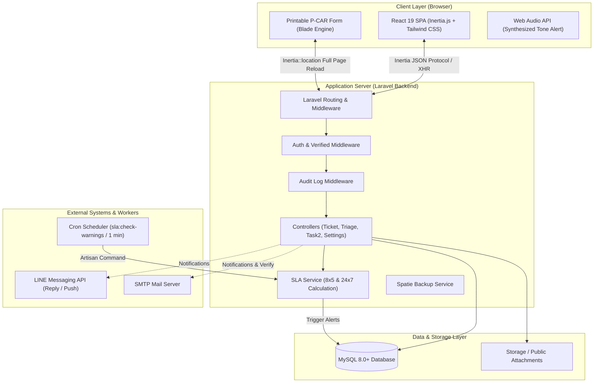
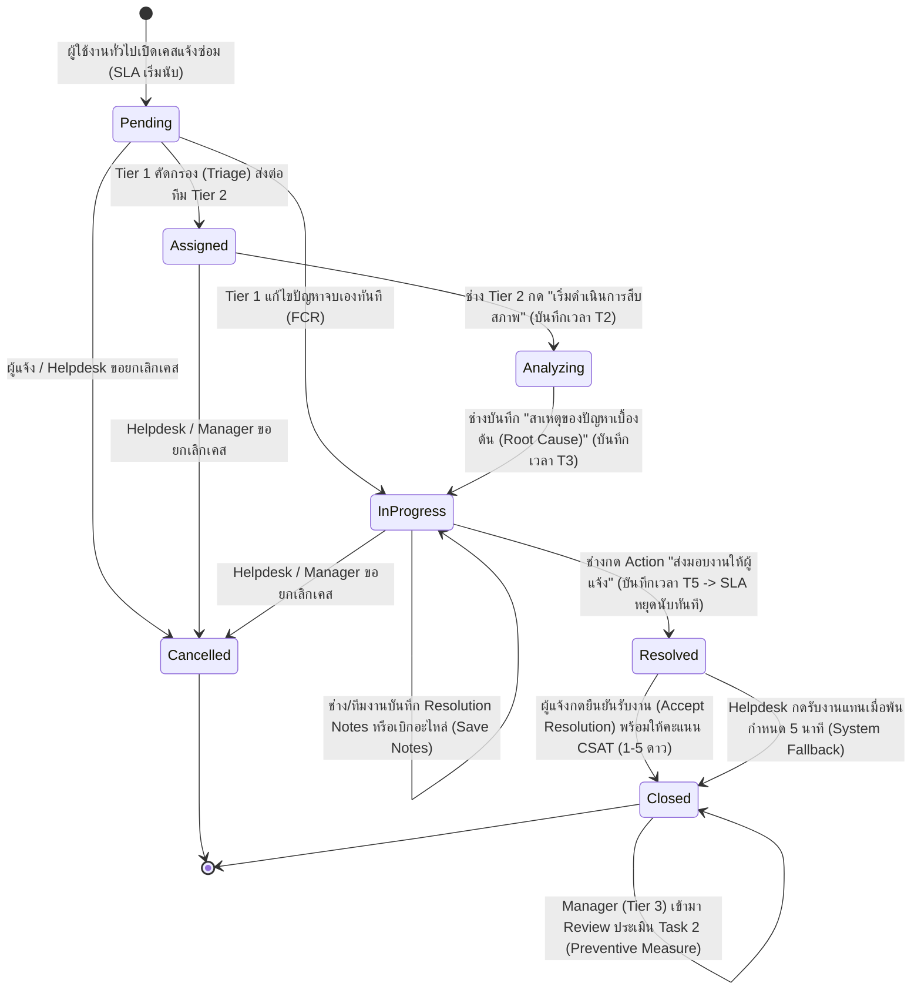
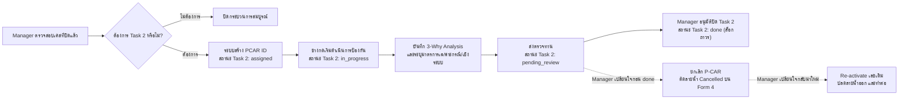
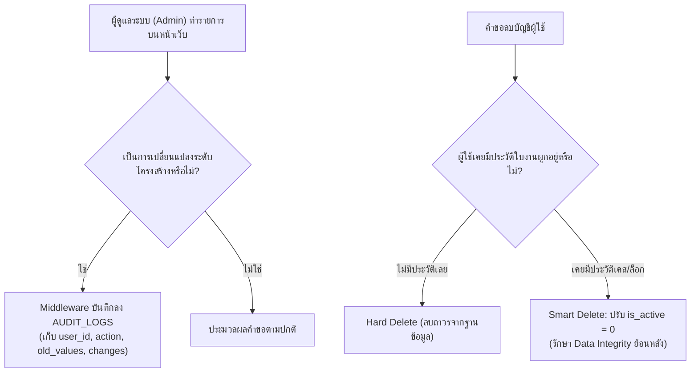

# 🏛️ System Architecture & Workflow Guidelines

เอกสารนี้อธิบายสถาปัตยกรรมเชิงระบบ (System Architecture), ตารางการกระจายสิทธิ์ (Role & Permission Matrix), การไหลของสถานะงาน (Workflow State Machine) และกลไกความปลอดภัยของระบบ **ITDeskService**

---

## 📌 สารบัญ (Table of Contents)
- [1. สถาปัตยกรรมระบบโดยรวม (System Architecture)](#1-สถาปัตยกรรมระบบโดยรวม-system-architecture)
- [2. ตารางสิทธิ์และการเข้าถึง 5 บทบาทหลัก (Role & Permission Matrix)](#2-ตารางสิทธิ์และการเข้าถึง-5-บทบาทหลัก-role--permission-matrix)
- [3. แผนภาพสถานะและวงจรชีวิตใบงาน (Ticket Lifecycle State Machine)](#3-แผนภาพสถานะและวงจรชีวิตใบงาน-ticket-lifecycle-state-machine)
- [4. วงจรชีวิตมาตรการป้องกันปัญหา (Task 2 & P-CAR Workflow)](#4-วงจรชีวิตมาตรการป้องกันปัญหา-task-2--p-car-workflow)
- [5. สถาปัตยกรรมเครื่องมือคำนวณและแจ้งเตือน SLA (SLA Engine Architecture)](#5-สถาปัตยกรรมเครื่องมือคำนวณและแจ้งเตือน-sla-sla-engine-architecture)
- [6. สถาปัตยกรรมความปลอดภัยและการตรวจสอบ (Security & Audit Architecture)](#6-สถาปัตยกรรมความปลอดภัยและการตรวจสอบ-security--audit-architecture)

---

## 1. สถาปัตยกรรมระบบโดยรวม (System Architecture)

ระบบ ITDeskService ได้รับการออกแบบภายใต้สถาปัตยกรรม **Hybrid Single Page Application (SPA)** โดยผสานความยืดหยุ่นของ React บน Frontend และความเสถียรของ Laravel บน Backend ผ่าน **Inertia.js** โดยมีแผนภาพการทำงานดังนี้:



### จุดสำคัญทางสถาปัตยกรรม:
1. **Hybrid Navigation (Inertia & Blade):** หน้าระบบหลักทำงานผ่าน Inertia React SPA แต่หน้าสำหรับพิมพ์รายงานเอกสารราชการ เช่น รายงาน P-CAR Form 4 (`print.blade.php`) จะถูกเรนเดอร์ผ่าน Blade View แท้เพื่อให้ได้ขนาดพอดีกระดาษ Legal แบบ Pixel-perfect โดยการเปลี่ยนเส้นทางข้ามระหว่าง Inertia กับ Blade ต้องใช้คำสั่ง `Inertia::location(...)` เสมอ เพื่อป้องกันปัญหาการเปิด Modal ซ้อนทับบนหน้าเดิม
2. **Audio Synthesis Architecture:** เสียงแจ้งเตือนของระบบสร้างขึ้นผ่าน Web Audio API สังเคราะห์คลื่นเสียง (Waveform Oscillator) ภายในเครื่องไคลเอนต์โดยตรง จึงไม่พึ่งพาไฟล์เสียงภายนอกและบันทึกโทนเสียงลงใน `localStorage`

---

## 2. ตารางสิทธิ์และการเข้าถึง 5 บทบาทหลัก (Role & Permission Matrix)

ระบบยึดหลักมาตรฐาน **ITIL 4** โดยแบ่งบทบาทเป็น 5 ระดับ พร้อมบังคับใช้หลักการแบ่งแยกหน้าที่ (**Separation of Duties**) เพื่อป้องกันผลประโยชน์ทับซ้อน

| สิทธิ์ / กิจกรรมในระบบ | `user` (ผู้ใช้) | `helpdesk` (Tier 1) | `technician` (Tier 2) | `manager` (Tier 3) | `administrator` (Admin) |
| :--- | :---: | :---: | :---: | :---: | :---: |
| **เปิดเคสแจ้งซ่อม (`POST /tickets`)** | ✅ **มีสิทธิ์คนเดียว** | ❌ ห้ามเปิด | ❌ ห้ามเปิด | ❌ ห้ามเปิด | ❌ ห้ามเปิด |
| **ดูแดชบอร์ดส่วนบุคคล (My Tickets)** | ✅ (เฉพาะของตน) | ❌ | ❌ | ❌ | ❌ |
| **ดูแดชบอร์ดภาพรวมทีมไอที** | ❌ | ✅ | ✅ (เฉพาะทีมตน) | ✅ (เฉพาะทีมที่ดูแล) | ✅ (ดูได้ทุกทีม) |
| **คัดกรองเคส (Triage) และจัดความเร่งด่วน** | ❌ | ✅ | ❌ | ✅ | ✅ |
| **เริ่มสืบสภาพ (Analyzing) และบันทึก Root Cause** | ❌ | ❌ | ✅ | ✅ | ✅ |
| **บันทึกวิธีแก้ปัญหา (Resolution Notes)** | ❌ | ✅ | ✅ | ✅ | ✅ |
| **ส่งมอบงานให้ผู้แจ้ง (`status = resolved`)** | ❌ | ✅ (กรณีจบเอง) | ✅ | ✅ | ✅ |
| **กดยืนยันรับผลงานและให้คะแนน CSAT** | ✅ (ผู้แจ้งจริง) | ⏳ (แทนได้หลัง 5 นาที) | ❌ | ❌ | ❌ |
| **แก้ไขข้อมูลย้อนหลัง (Inline Edit)** | ❌ | ✅ (จนกว่า Task 2 จบ) | ✅ (จนกว่า Task 2 จบ) | ✅ (จนกว่า Task 2 จบ) | ✅ (จนกว่า Task 2 จบ) |
| **ยกเลิกใบงาน (Cancel Ticket)** | ✅ (ก่อนส่งมอบ) | ✅ (ก่อนส่งมอบ) | ❌ ห้ามยกเลิก | ✅ (ก่อนส่งมอบ) | ✅ |
| **เปิด/ยกเลิก/Re-activate Task 2 (P-CAR)** | ❌ | ❌ | ❌ | ✅ **มีสิทธิ์คนเดียว** | ✅ |
| **ปฏิบัติการ Task 2 และพิมพ์รายงาน P-CAR** | ❌ | ❌ | ✅ (ช่างเฉพาะทาง) | ✅ | ✅ |
| **เลื่อนขั้น (Promote) / ลดบทบาท (Demote)** | ❌ | ❌ | ❌ | ✅ (ทีมในสังกัด) | ✅ |
| **ส่งลิงก์รีเซ็ตรหัสผ่านให้ผู้ใช้** | ❌ | ✅ | ❌ | ✅ | ✅ |
| **จัดการโครงสร้างบริษัทและแผนก (Companies/Depts)** | ❌ | ❌ | ❌ | ❌ | ✅ **มีสิทธิ์คนเดียว** |
| **จัดการบัญชีผู้ใช้ (สร้าง/แก้/ลบ/Smart Delete)** | ❌ | ❌ | ❌ | ❌ | ✅ **มีสิทธิ์คนเดียว** |
| **ดูและจัดการ Audit Logs** | ❌ | ❌ | ❌ | ❌ | ✅ **มีสิทธิ์คนเดียว** |
| **สำรองข้อมูลระบบ (System Backup)** | ❌ | ❌ | ❌ | ❌ | ✅ **มีสิทธิ์คนเดียว** |
| **แก้ไขการตั้งค่าระบบ (Branding & SMTP)** | ❌ | ❌ | ❌ | ❌ | ✅ **มีสิทธิ์คนเดียว** |

> [!IMPORTANT]
> **หลักการ Separation of Duties (การป้องกันผลประโยชน์ทับซ้อน):**
> ทีมงานไอทีและผู้ดูแลระบบทุกระดับ (Tier 1–3 และ Administrator) จะไม่สามารถเปิดเคสแจ้งซ่อมได้ หากพยายามเข้าหน้า `/tickets/create` ระบบจะ Redirect กลับไปยังหน้า Dashboard ทันที และหากส่งคำขอตรงผ่าน API จะถูกปฏิเสธด้วย HTTP `403 Forbidden`

---

## 3. แผนภาพสถานะและวงจรชีวิตใบงาน (Ticket Lifecycle State Machine)



### การจับเวลาและหลักเกณฑ์ของแต่ละช่วงเวลา (Time Metrics):
- **T1 (`assigned_at`):** เวลารับแจ้งและมอบหมายงาน (บันทึกโดย `assigned_by`)
- **T2 (`analyzing_at`):** เวลาเริ่มการสืบสภาพปัญหา (บันทึกโดย `analyzing_by`)
- **T3 (`in_progress_at`):** เวลาเริ่มลงมือปฏิบัติการซ่อมจริงหลังจากระบุ Root Cause (บันทึกโดย `in_progress_by`)
- **T5 (`resolved_at`):** เวลาส่งมอบงานให้ผู้แจ้ง (บันทึกโดย `resolved_by`) ➔ **หยุดนับเวลา SLA ณ วินาทีนี้ทันที**
- **Closed (`closed_at`):** เวลาปิดเคสสมบูรณ์หลังจากผู้แจ้งยอมรับผลงานและให้คะแนน CSAT

---

## 4. วงจรชีวิตมาตรการป้องกันปัญหา (Task 2 & P-CAR Workflow)

กระบวนการ P-CAR (Problem-Corrective Action Report) ทำงานต่อเนื่องหลังจากใบงานหลักปิด (`closed`) เพื่อมุ่งเน้นการป้องกันปัญหาซ้ำซาก:



---

## 5. สถาปัตยกรรมเครื่องมือคำนวณและแจ้งเตือน SLA (SLA Engine Architecture)

ระบบคำนวณ SLA ทำงานแบบผสมผสานระหว่าง Real-time Calculation และ Scheduled Background Checking:

1. **โหมด SLA 8x5 (เวลาทำการ):**
   - นับเฉพาะวันจันทร์–ศุกร์ เวลา 08:00–12:00 น. และ 13:00–17:00 น. (วันละ 8 ชั่วโมง ไม่นับพักเที่ยง)
   - ข้ามวันหยุดเสาร์–อาทิตย์ และวันหยุดนักขัตฤกษ์ในตาราง `HOLIDAYS` โดยอัตโนมัติ
2. **โหมด SLA 24x7 (ตลอด 24 ชั่วโมง):**
   - นับเวลาต่อเนื่องทุกวันตลอด 24 ชั่วโมง ไม่เว้นวันหยุด
3. **ระบบตรวจจับและแจ้งเตือนล่วงหน้า (SLA Alert Command):**
   - ทำงานผ่าน Artisan Command:
     ```bash
     php artisan sla:check-warnings
     ```
   - สั่งรันทุก 1 นาทีผ่าน Laravel Scheduler
   - ตรวจจับเคสที่เวลาคงเหลือน้อยกว่าค่า `sla_warning_threshold_minutes` ใน Settings
   - ส่งการแจ้งเตือนแบบ Multi-channel: **Database In-App Alert**, **Email Notification**, และ **LINE Notify Log**
   - มีฟิลด์ `sla_warning_sent_at` และ `sla_breached_sent_at` บนตาราง `HELPDESK_CASES` เพื่อป้องกันการส่งแจ้งเตือนซ้ำซ้อน

---

## 6. สถาปัตยกรรมความปลอดภัยและการตรวจสอบ (Security & Audit Architecture)



### มาตรการความปลอดภัยหลัก:
- **Smart Delete Policy:** ป้องกันความสัมพันธ์ของฐานข้อมูลเสียหาย (Data Integrity) โดยจะ Hard Delete เฉพาะบัญชีที่ไม่มีข้อมูลอ้างอิง และใช้ Soft Deactivation (`is_active = 0`) กับบัญชีที่มีประวัติใบงาน
- **Non-tamperable Administrator Profile:** ไม่อนุญาตให้ Administrator เปลี่ยนชื่อตนเองผ่านหน้าเว็บ เพื่อป้องกันการปลอมแปลงประวัติใน Audit Logs
- **Safe Impersonation (Login As):** เมื่อ Administrator สลับไปสวมบทบาทเป็นผู้ใช้งานอื่น ระบบจะ**ไม่บันทึกเวลา `last_login_at`** เพื่อรักษาความถูกต้องของสถิติผู้ใช้งานที่ไม่มีการเคลื่อนไหว (Inactive Users)
- **Settings Audit Log Immunity:** การบันทึกประวัติแก้ไขการตั้งค่าระบบถูกกำหนดให้ `target_id = null` เพื่อป้องกันข้อผิดพลาด MySQL 1366 Data Truncation จากข้อมูลชนิด Key-Value
